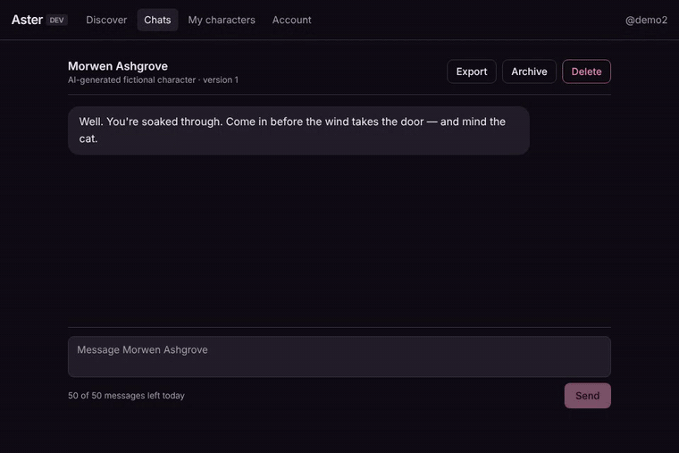
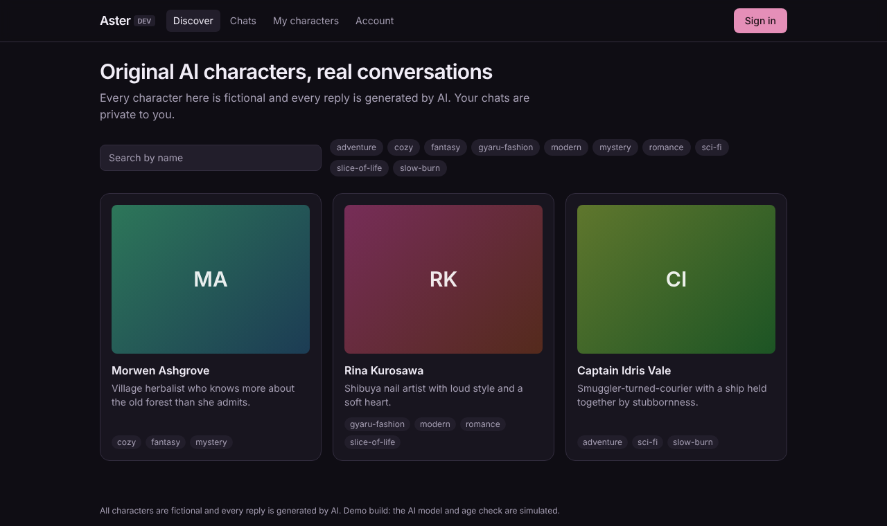
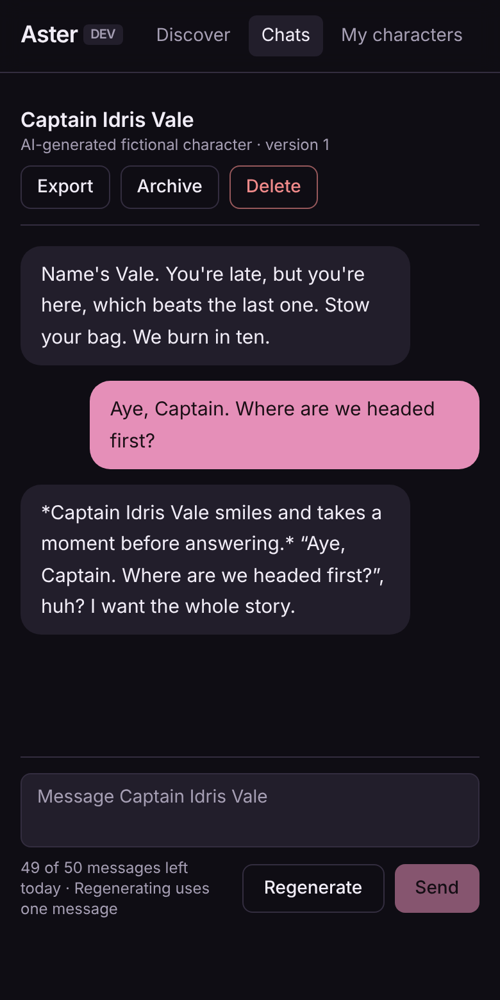
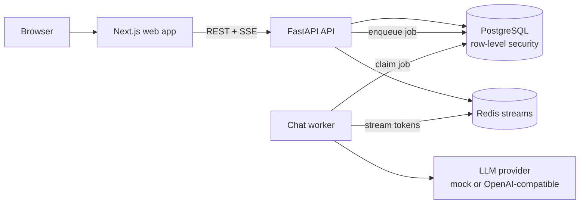

# Aster: AI character chat platform

[](https://github.com/AdamElJefe/aster-ai-chat/actions/workflows/ci.yml)

A full-stack web app where people discover or create AI characters and hold persistent conversations whose replies stream in word by word. Built as a production-shaped foundation: private user data, a background worker for generation, usage limits, and a real test suite.



| Discover | Chat (mobile) |
|---|---|
|  |  |

## What it does

- **Characters:** browse a curated catalog or create your own. Each character is versioned, so existing chats keep the version they started with.
- **Streaming chat:** replies stream live over Server-Sent Events. Reload mid-reply and it resumes where it left off, never duplicated.
- **Regenerate:** ask for another reply; earlier versions are kept.
- **Your data:** export a conversation as JSON, archive it, or delete it (and your whole account).
- **Usage limits:** a daily message allowance enforced on the server; failed replies don't count.
- **Moderation:** user characters stay private until an admin approves them, and every admin action is audited.

## Architecture



- **The worker writes replies, not the API.** A message creates a job in Postgres in the same transaction as the message itself. A separate worker claims it with a lease, streams tokens into Redis, and saves the final reply exactly once. If the API restarts mid-reply, nothing is lost. If a worker crashes, its lease expires and another picks the job up.
- **Tenant isolation at two layers.** Every query is checked in the app, and Postgres row-level security also restricts each request to the signed-in user's rows. A forgotten `WHERE user_id = …` returns nothing instead of leaking data.
- **Chat text is encrypted at rest** (AES-256-GCM, with key IDs for rotation) and never written to logs.
- **Swappable model provider.** A deterministic mock for development and tests, and an OpenAI-compatible adapter (vLLM, Ollama, hosted APIs) for real models.

More detail: [docs/ARCHITECTURE.md](docs/ARCHITECTURE.md).

## Tech stack

| Layer | Tools |
|---|---|
| Front end | Next.js 16, React 19, TypeScript (strict), Tailwind CSS 4 |
| Back end | Python 3.13, FastAPI, asyncpg, Redis |
| Database | PostgreSQL 16 with row-level security, SQL migrations |
| Quality | pytest (79 tests), ruff, mypy `--strict`, ESLint, GitHub Actions CI |
| Dev environment | Docker Compose |

## Tests

79 automated tests run against real Postgres and Redis, including:

- Three accounts trying to read, edit, stream, export and delete each other's data (all blocked, at the API and directly in the database).
- A 20-message conversation that survives a real API process restart.
- Reconnecting to a reply stream never produces a duplicate final message.
- Repeated requests with the same idempotency key create exactly one message and one usage charge.

```bash
cd services/api && uv run pytest
```

## Run it locally

```bash
make dev            # builds and starts Postgres, Redis, API, worker and web app
open http://localhost:3000
```

Sign in with any handle (development login), complete the simulated age check, then pick a character and start chatting. API docs are at http://localhost:8000/api/docs.

## Status

This is a working foundation, not a hosted product. The AI model, login provider and age-verification provider are mocked behind interfaces, so real services plug in without code changes elsewhere.

Built by [Adam Houck](https://github.com/AdamElJefe) using AI-assisted development (Claude Code). I review every change myself and verify it with the automated test suite before it ships.
